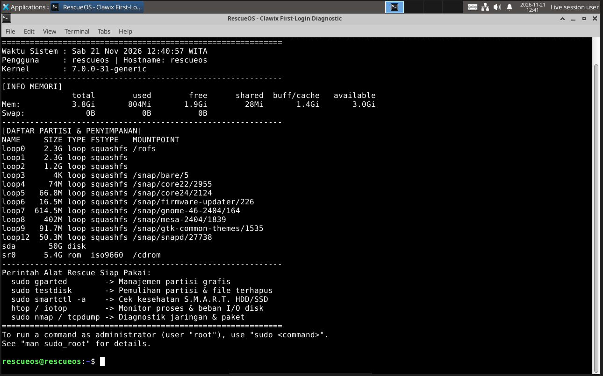
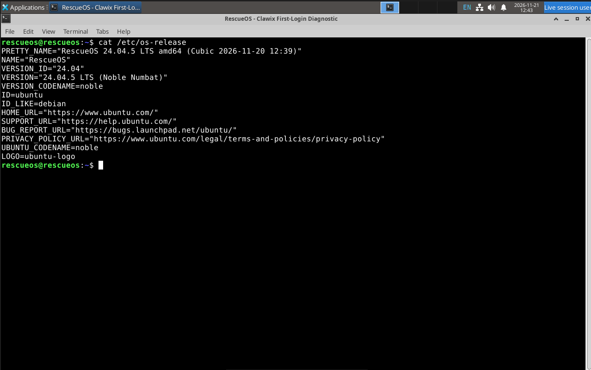
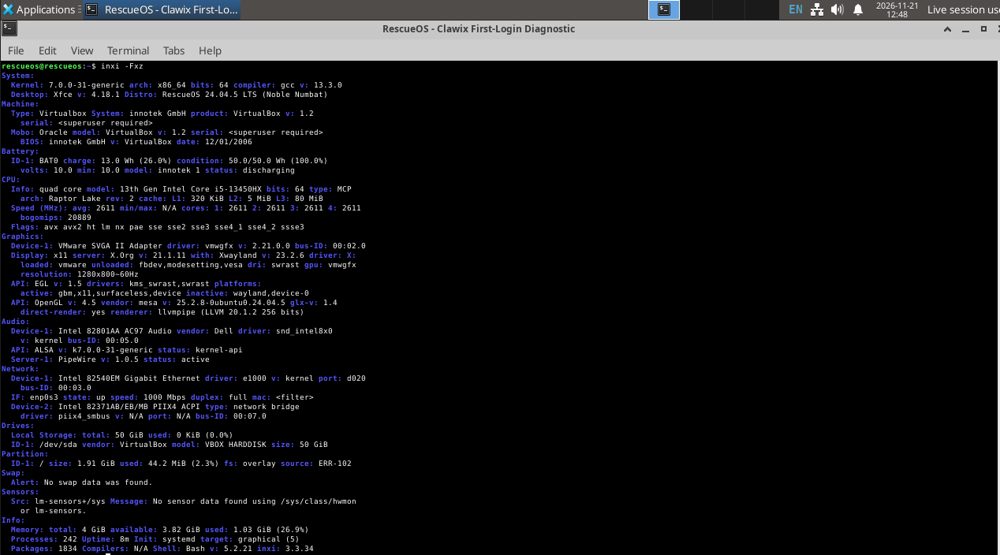
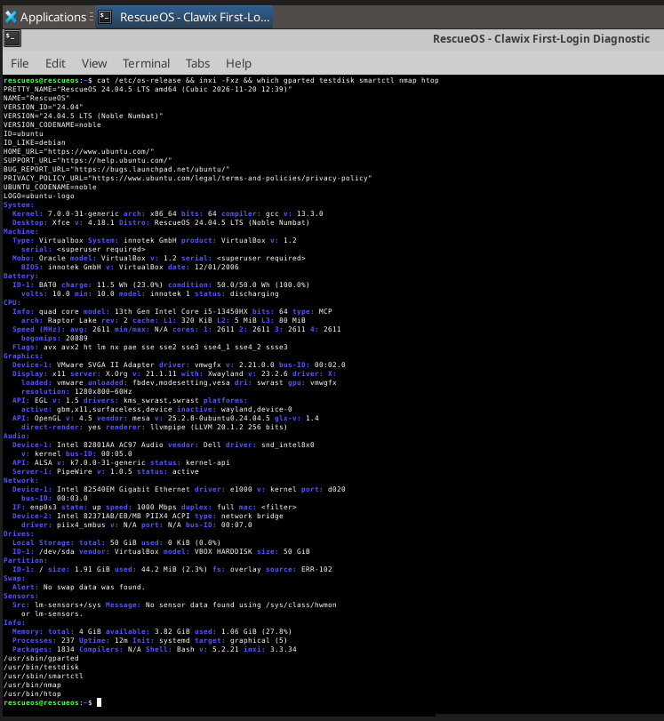

# RescueOS 24.04.5 LTS (Clawix Edition)

**RescueOS** adalah distribusi Linux kustom berbasis **Ubuntu 24.04.5 LTS (Noble Numbat)** dengan lingkungan desktop ringan **XFCE 4.18.1** yang dirancang khusus untuk keperluan *system recovery*, manajemen partisi, pemulihan data, serta diagnostik jaringan dan perangkat keras.

## Unduh File ISO
- **Nama File:** `RescueOS-24.04.5-amd64.iso` (5,4 GB)
- **Tautan Google Drive:** `https://drive.google.com/file/d/1sLOyG8vowfhIf6vKsmCc7_XW4jroEvew/view`
- **Verifikasi Integritas:** File checksum `.sha256` dan `.md5` tersedia di folder `configs/`.

## Perbandingan Sebelum vs. Sesudah Kustomisasi

| Parameter | Ubuntu 24.04.5 LTS (Original) | RescueOS 24.04.5 LTS (Clawix) |
| :--- | :--- | :--- |
| **Desktop Environment** | GNOME Desktop | **XFCE 4.18.1** + LightDM |
| **Identitas Sistem** | Ubuntu 24.04.5 LTS | **RescueOS 24.04.5 LTS amd64** |
| **Konsumsi RAM (Idle Live)** | ~1,4 – 1,8 GiB | **~804 MiB – 1,03 GiB** |
| **Utilitas Pemulihan** | Terbatas (instal manual) | **Lengkap** (`gparted`, `testdisk`, `smartmontools`, `ddrescue`, `nmap`, `htop`, `inxi`, dll.) |
| **Otomatisasi Sesi Live** | Tidak ada | **First-Login Diagnostic Terminal** (`scripts/rescueos-firstlogin.sh`) |
| **Branding Visual** | Standar Ubuntu | **Tema & Wallpaper Clawix** |

## Struktur Repositori
- `branding/` — Aset visual kustom (logo & *wallpaper* Clawix)
- `configs/` — Konfigurasi build Cubic (`cubic.conf`), daftar paket, autostart desktop, dan checksum SHA256/MD5
- `docs/` — Dokumentasi *screenshot* hasil pengujian *Live Boot* dan diagnostik sistem
- `scripts/` — Skrip diagnostik otomatis saat *first-login* (`rescueos-firstlogin.sh`)

## Hasil Pengujian (VirtualBox)

### 1. Tampilan Desktop XFCE & Branding Clawix

### 2. Terminal Diagnostik Otomatis (*First-Login*)

### 3. Verifikasi Identitas Distro (`/etc/os-release`)

### 4. Spesifikasi Sistem & Kelengkapan Paket (`inxi -Fxz` & `which`)

