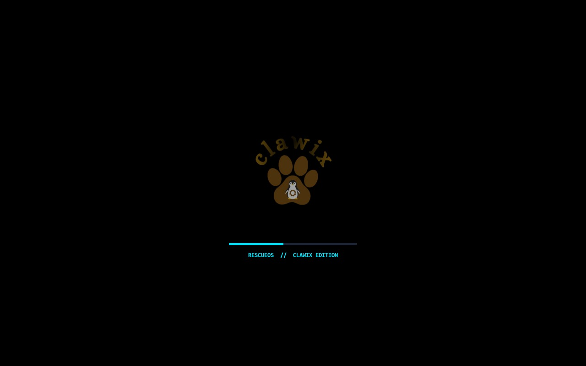
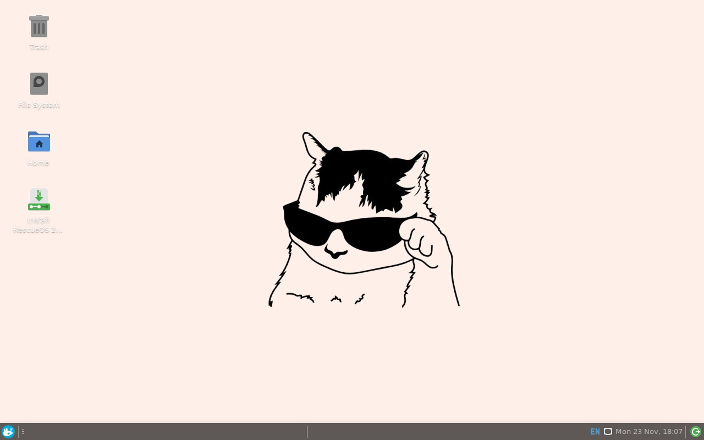
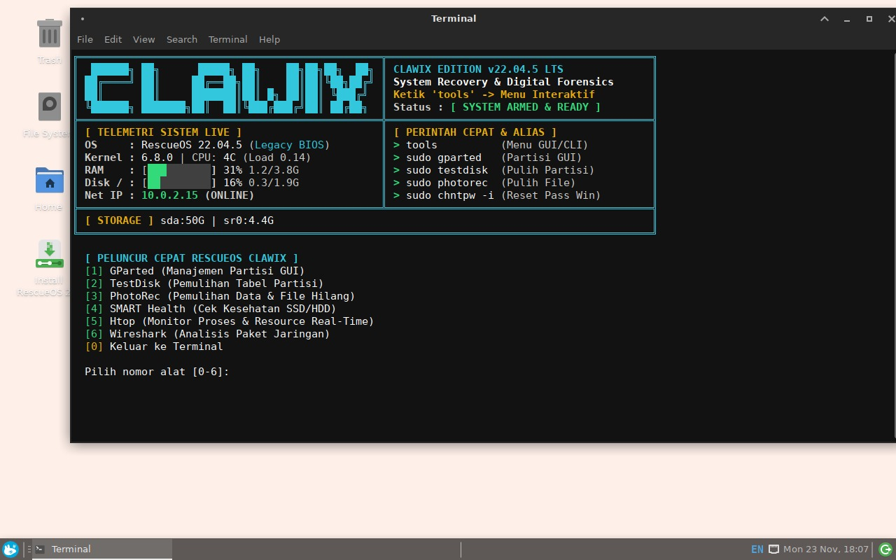
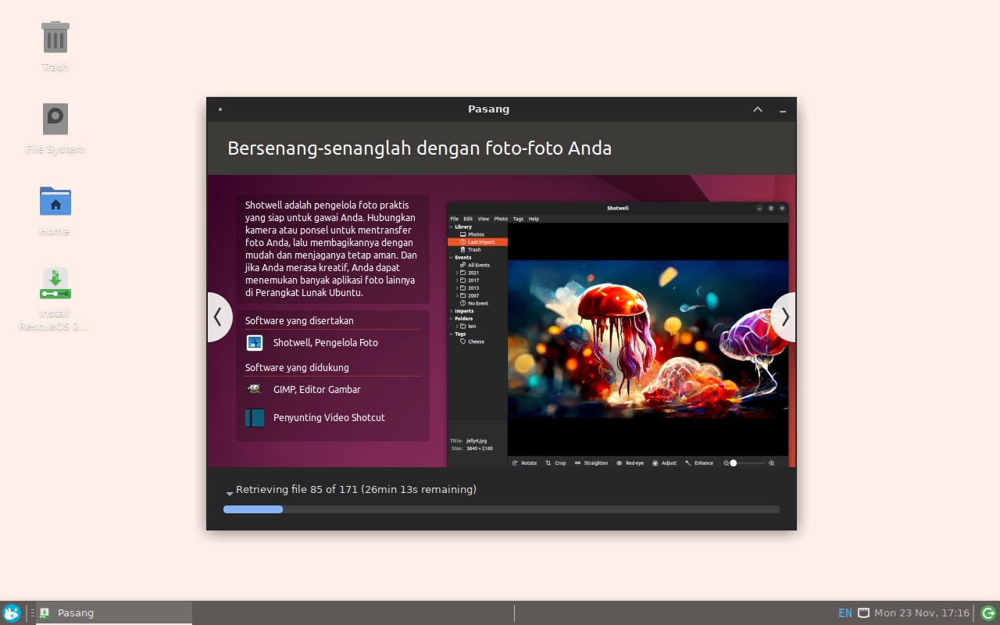
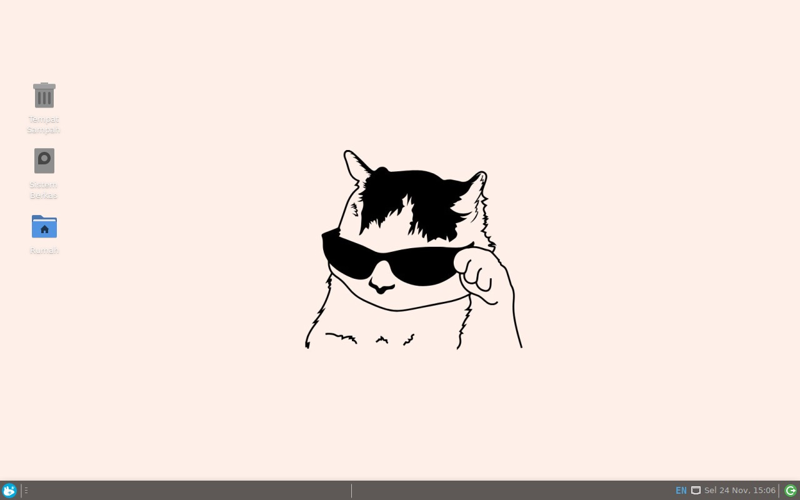
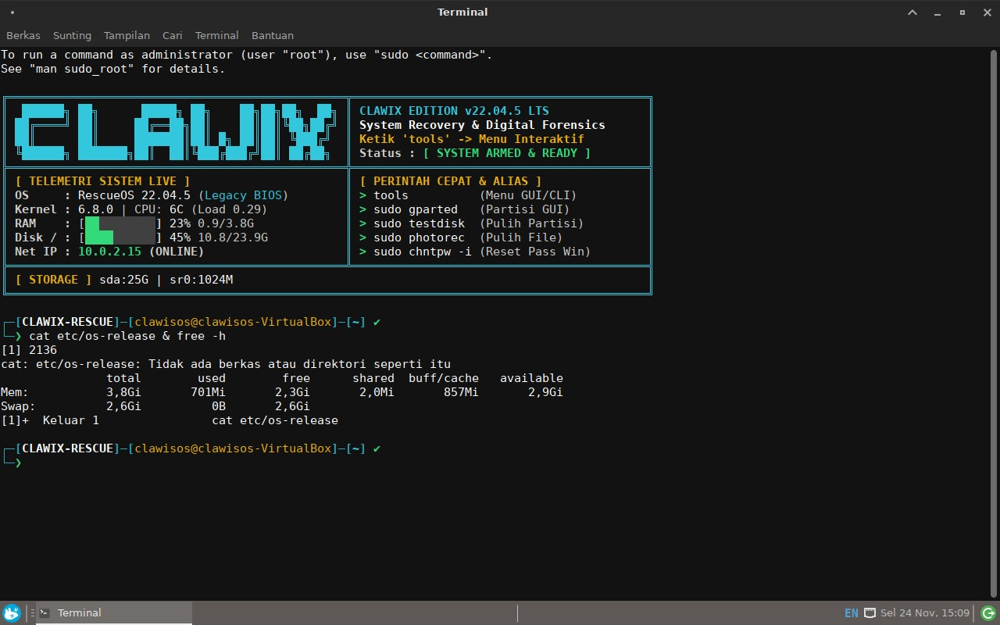

# 📁 Tahap 1 — Base System, 22 Toolkit & Clawix Cyber Branding

Dokumentasi lengkap proses *remastering* **RescueOS (Clawix Edition)** pada **Tahap 1** berbasis **Ubuntu 22.04.5 LTS** menggunakan **Cubic** dengan kompresi SquashFS `zstd`.

## Unduh File ISO (Tahap 1)
- **Nama File:** `RescueOS-Clawix-22.04.5-amd64.iso`
- **Arsitektur & Boot:** 64-bit (`amd64`) — Mendukung **UEFI** & **Legacy BIOS**
- **Tautan Unduhan:** *(https://drive.google.com/drive/folders/1GBOxqodlAw0F769KSsTuAAmFoC00cOkF?usp=sharing)*

## Perbandingan Sebelum vs. Sesudah Kustomisasi

| Parameter | Ubuntu 22.04.5 LTS (Original) | RescueOS 22.04.5 LTS (Clawix) |
| :--- | :--- | :--- |
| **Desktop Environment** | GNOME Desktop | **XFCE4** (`Materia-dark` + `Papirus-Dark`) |
| **Identitas & Boot Splash** | Standar Ubuntu | **Plymouth Clawix Cyber-Pulse** & Branding Clawix |
| **Konsumsi RAM (Idle Live)** | ~1,3 – 1,6 GiB | **~690 MiB** |
| **Kebersihan Sistem** | Terpasang game & telemetri (`apport`, `whoopsie`) | **Bebas *bloatware*, game, dan *pop-up* error** |
| **Utilitas Pemulihan** | Terbatas (instal manual) | **22 Paket Lengkap** (*Recovery, Forensics & Diagnostics*) |
| **Otomatisasi Terminal** | Terminal standar | **Cyber HUD Telemetri Live** (`rescueos-banner`) & Menu **`tools`** |

## Daftar 22 Perkakas Bawaan (Pre-Installed Toolkit)

| No | Nama Paket | Kategori | Fungsi Utama |
| :-: | :--- | :--- | :--- |
| 1 | `gparted` | Partisi & Recovery | Manajemen, pemotongan, dan perbaikan partisi disk berbasis GUI |
| 2 | `testdisk` | Partisi & Recovery | Pemulihan tabel partisi hilang/rusak (termasuk `photorec` untuk *file recovery*) |
| 3 | `gddrescue` | Partisi & Recovery | Kloning dan penyelamatan data dari disk/SSD dengan *bad sector* (`ddrescue`) |
| 4 | `partclone` | Partisi & Recovery | Pencadangan dan pemulihan blok partisi sistem file secara cepat |
| 5 | `fsarchiver` | Partisi & Recovery | Pengarsipan dan pemulihan sistem file lintas ukuran partisi |
| 6 | `extundelete` | Partisi & Recovery | Pemulihan file terhapus khusus partisi Linux `ext3` dan `ext4` |
| 7 | `foremost` | Forensik Data | *File carving* forensik berdasarkan *header* dan *footer* biner |
| 8 | `scalpel` | Forensik Data | Pemulihan file forensik berkecepatan tinggi berbasis pola struktur file |
| 9 | `sleuthkit` | Forensik Data | Analisis forensik sistem file, *inode*, dan *timeline* artefak disk |
| 10 | `chntpw` | Akses & Auth | Reset kata sandi akun lokal Windows dan penyuntingan *Windows Registry* |
| 11 | `smartmontools` | Diagnostik Hardware | Pengecekan kesehatan fisik dan parameter S.M.A.R.T. HDD/SSD (`smartctl`) |
| 12 | `hdparm` | Diagnostik Hardware | Pengujian kecepatan baca dan parameter *drive* SATA/IDE |
| 13 | `nvme-cli` | Diagnostik Hardware | Diagnostik kesehatan, suhu, dan *wear-level* SSD NVMe |
| 14 | `dmidecode` | Diagnostik Hardware | Pembacaan detail BIOS/UEFI, *motherboard*, prosesor, dan slot RAM |
| 15 | `lshw` | Diagnostik Hardware | Inventarisasi lengkap spesifikasi perangkat keras yang terdeteksi |
| 16 | `memtester` | Diagnostik Hardware | Pengujian stabilitas dan deteksi kerusakan sektor memori RAM |
| 17 | `ntfs-3g` | Sistem File | Dukungan baca/tulis penuh dan perbaikan *error* partisi Windows NTFS (`ntfsfix`) |
| 18 | `exfatprogs` | Sistem File | Pembuatan, pengecekan, dan perbaikan partisi exFAT (flashdisk/SD card) |
| 19 | `nmap` | Diagnostik Jaringan | Pemindaian *host*, *port* terbuka, dan layanan dalam jaringan lokal |
| 20 | `wireshark` | Diagnostik Jaringan | Analisis paket lalu lintas jaringan secara mendalam berbasis GUI |
| 21 | `htop` | Monitoring Sistem | Pemantauan proses aktif, beban CPU, dan penggunaan RAM secara *real-time* |
| 22 | `strace` | Monitoring Sistem | Pelacakan *system call* untuk *debugging* proses yang mengalami *crash* |

## Struktur Folder `tahap1/`
- `branding/` — Aset visual kustom (logo & *wallpaper* Clawix)
- `configs/` — Konfigurasi `xfce4-terminal` (`terminalrc`)
- `docs/` — Dokumentasi *screenshot* hasil pengujian *Live Boot* di VirtualBox
- `scripts/` — Skrip HUD telemetri terminal (`rescueos-banner`) dan peluncur interaktif (`rescue-tools`)

## Hasil Pengujian (VirtualBox)

### 1. Animasi Boot Splash Plymouth (Clawix Cyber-Pulse)

### 2. Tampilan Desktop Live XFCE4 (Clawix Edition)

### 3. Cyber Terminal HUD & Peluncur Interaktif (`tools`)

### 4. Proses Instalasi Sistem Operasi ke Disk

### 5. Tampilan Desktop Pasca-Instalasi Permanen

### 6. Verifikasi Efisiensi Memori (`free -h` — 701 MiB Idle)

